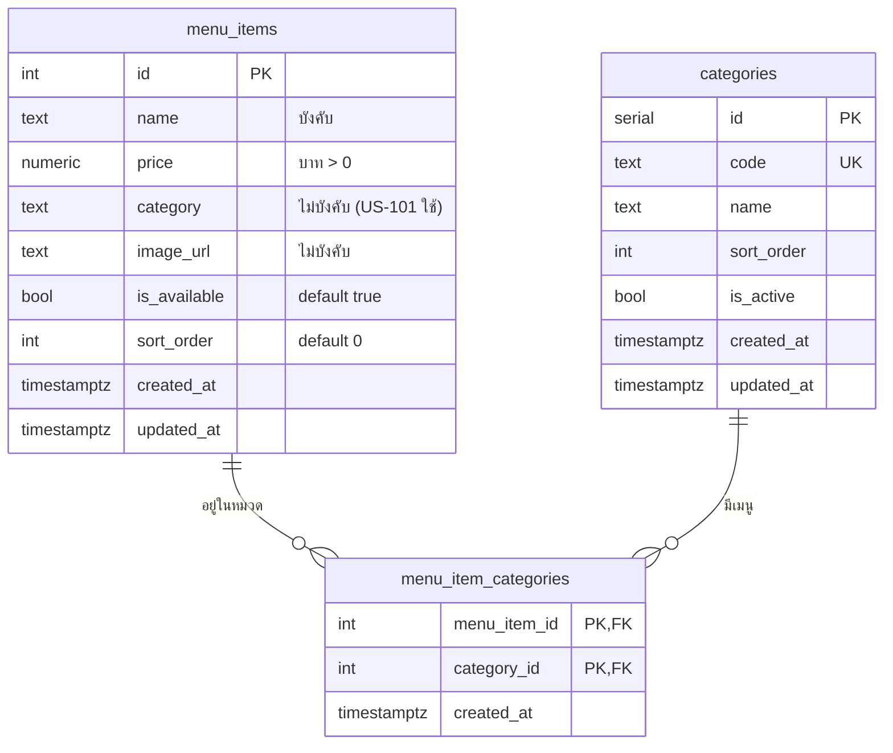

# Data Model — Office Food Ordering (US-101)

- เวอร์ชันเอกสาร: 1.0 (App v1.0.0, req v1.1) | ผู้จัดทำ: 202 Dev | วันที่: 2026-11-18
- Supabase project: `vibecode-office-food` (ref `yhcjsgbffgabsmsybnle`, region ap-southeast-1) | schema: `public`
- ไฟล์ SQL: `db/001_us101_menu_schema.sql` (โครงสร้าง), `db/002_us101_seed_sample.sql` (ข้อมูลตัวอย่าง)

## 1. ภาพรวม (ER Diagram)



ความสัมพันธ์: **menu_items ↔ categories เป็น Many-to-Many** ผ่านตารางเชื่อม `menu_item_categories`
(1 เมนูอยู่ได้หลายหมวด, 1 หมวดมีได้หลายเมนู) — เตรียมไว้สำหรับอนาคต

> **US-101 หน้าเว็บใช้เฉพาะตาราง `menu_items` (รวมคอลัมน์ข้อความ `category`)** ยังไม่อ่าน `categories` / `menu_item_categories`

## 2. ตาราง `menu_items` — เมนูอาหาร (ใช้งานจริง)

| คอลัมน์ | ชนิด | บังคับ | ค่าเริ่มต้น | ความหมาย / เงื่อนไข |
|---|---|---|---|---|
| id | integer (PK) | ✔ | – | รหัสเมนู กำหนดเอง ห้ามซ้ำ |
| name | text | ✔ | – | ชื่อเมนูที่แสดง |
| price | numeric(10,2) | ✔ | – | ราคาต่อหน่วย (บาท) ทศนิยม 2 ตำแหน่ง **ต้อง > 0** (CHECK) ใส่ 0/ติดลบจะถูกปฏิเสธ |
| category | text | – | null | หมวดแบบข้อความ เช่น ข้าว, เส้น แสดงบนการ์ดเมนู |
| image_url | text | – | null | URL รูปภาพ ว่าง/โหลดไม่ได้ → แสดงไอคอน 🍱 แทน |
| is_available | boolean | ✔ | true | **สถานะ:** `true` = มีขาย → แสดง ให้เลือกได้ / `false` = หมด/งดขาย → **ไม่แสดง** |
| sort_order | integer | ✔ | 0 | ลำดับแสดง ค่าน้อยแสดงก่อน (เท่ากันเรียงตาม id) |
| created_at | timestamptz | ✔ | now() | เวลาสร้างแถว |
| updated_at | timestamptz | ✔ | now() | เวลาแก้ไขล่าสุด (trigger `set_updated_at` อัปเดตอัตโนมัติ) |

หน้าเว็บดึงข้อมูลด้วย: `is_available = true` เรียง `sort_order asc, id asc`

## 3. ตาราง `categories` — หมวดหมู่ (อนาคต)

| คอลัมน์ | ชนิด | ความหมาย |
|---|---|---|
| id | serial (PK) | รหัสหมวด รันอัตโนมัติ |
| code | text (UNIQUE) | รหัสย่อ เช่น rice, noodle, isan, drink |
| name | text | ชื่อที่แสดง เช่น ข้าว |
| sort_order | integer (0) | ลำดับแสดง |
| is_active | boolean (true) | **สถานะ:** `true` = ใช้งาน / `false` = ปิด (ซ่อน) |
| created_at / updated_at | timestamptz | เวลาสร้าง / แก้ไขล่าสุด (อัตโนมัติ) |

ข้อมูลตั้งต้นที่ใส่แล้ว: rice=ข้าว, noodle=เส้น, isan=อีสาน, drink=เครื่องดื่ม

## 4. ตาราง `menu_item_categories` — ตารางเชื่อม M:N (อนาคต)

| คอลัมน์ | ชนิด | ความหมาย |
|---|---|---|
| menu_item_id | integer FK → menu_items.id | ON DELETE CASCADE (ลบเมนู → ลบการผูกด้วย) |
| category_id | integer FK → categories.id | ON DELETE CASCADE (ลบหมวด → ลบการผูกด้วย) |
| created_at | timestamptz | เวลาที่ผูก |

PK = (menu_item_id, category_id) → ผูกเมนูกับหมวดเดิมซ้ำไม่ได้

## 5. ความปลอดภัย (RLS)

- เปิด Row Level Security ทั้ง 3 ตาราง
- Policy: `SELECT` อย่างเดียว สำหรับ role `anon`, `authenticated` (หน้าเว็บอ่านได้อย่างเดียว)
- ไม่มี policy INSERT/UPDATE/DELETE → publishable key ในหน้าเว็บแก้ข้อมูลไม่ได้ (ทดสอบแล้ว: POST ได้ 401 / 42501)
- การเพิ่ม/แก้ข้อมูลทำผ่าน Supabase Dashboard หรือ SQL Editor (สิทธิ์เจ้าของโปรเจกต์)
- (v1.0.2, `db/003`) สิทธิ์ระดับตาราง: ถอน INSERT/UPDATE/DELETE/TRUNCATE/TRIGGER/REFERENCES จาก anon, authenticated เหลือ **SELECT อย่างเดียว** เป็นชั้นป้องกันที่สองนอกจาก RLS
- ถ้าสร้างตารางใหม่ใน schema public ในอนาคต ให้ REVOKE สิทธิ์เขียนแบบเดียวกัน (ค่าเริ่มต้นของ Supabase ให้สิทธิ์ครบ)

## 6. วิธีแก้ไข / เพิ่มเมนู

Supabase Dashboard → Table Editor → `menu_items` แล้วแก้ไขได้เลย หรือใช้ SQL:

```sql
-- เพิ่มเมนู
insert into public.menu_items (id, name, price, category, image_url, is_available, sort_order)
values (13, 'ข้าวไข่เจียว', 40.00, 'ข้าว', null, true, 13);
-- ทำให้เมนูหมด (ซ่อนจากหน้าเว็บ)
update public.menu_items set is_available = false where id = 13;
-- เปลี่ยนราคา
update public.menu_items set price = 45.00 where id = 13;
```

นำเข้าจาก CSV: Table Editor → `menu_items` → Insert → Import data from CSV (หัวคอลัมน์ตาม `Design/data/menu_items.csv`)

หน้าเว็บอ่านข้อมูลใหม่ทุกครั้งที่โหลดหน้า (ไม่ต้อง Deploy ใหม่)

## 7. แผนใช้ Many-to-Many ในอนาคต

เมื่อมี Story เช่น "กรองเมนูตามหมวด" หรือ "1 เมนูอยู่หลายหมวด (เช่น ทั้ง 'ข้าว' และ 'เมนูแนะนำ')":

```sql
-- ผูกเมนู id 1 กับหมวด rice
insert into public.menu_item_categories (menu_item_id, category_id)
select 1, id from public.categories where code = 'rice';
```

ฝั่งเว็บดึงผ่าน PostgREST: `/rest/v1/menu_items?select=*,categories(code,name)&is_available=eq.true`
แล้วค่อยเลิกใช้คอลัมน์ `menu_items.category` (ต้องเป็น Story ใหม่ที่ BA อนุมัติ)

## 8. ข้อมูลทดสอบ

- `db/002_us101_seed_sample.sql`: ส่วน categories **apply แล้ว**; ส่วน menu_items 6 แถว **ไม่ได้ apply โดยตั้งใจ**
- `menu_items` ใน Production ว่างไว้ให้ 203 Tester import Mock Data (`Design/data/menu_items.csv/.json`, 12 แถว) เพื่อใช้เทียบ AC1
- รายการที่ผู้ใช้เลือก (ตะกร้า) **ไม่เก็บในฐานข้อมูล** เก็บใน memory ของหน้าเว็บเท่านั้น รีเฟรชแล้วล้าง (BA-C2)
